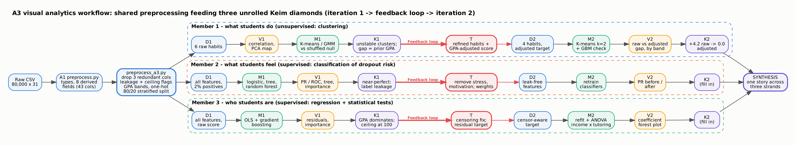

# DAS732 A3: Visual Analytics of Student Habits, Wellbeing and Performance

**Team:** Kolipakula Sai Tushaar, Advaya Bhardwaj, Aman Kumar Lahoti

**Deadline:** 29 November 2026, 11:59 pm IST (team target: 27 November) · **Viva/demo:** week of 30 November, all members attend

> **Advaya and Aman: start with [TEAM_INSTRUCTIONS.md](TEAM_INSTRUCTIONS.md).** It lists exactly what is left for each of you, with expected numbers.



## Status

| Part | Owner | Status |
|---|---|---|
| Shared A3 preprocessing (`preprocess_a3.py`, `a3_common.py`) | Tushaar | ✅ done |
| Team workflow diagram, report Sections 2–3 | Tushaar | ✅ done (M2/M3 fill their K2 boxes) |
| Member 1: clustering workflow, 10 figures, report Section 4 | Tushaar | ✅ done |
| Report skeleton (`report/main.tex`, compiles now, A1 appendix attached) | Tushaar | ✅ done |
| Member 2: classification of dropout risk, Section 5 | Advaya | ⏳ starter script runs; figures and text to do |
| Member 3: regression and statistical tests, Section 6 | Aman | ⏳ starter script runs; figures and text to do |
| Introduction, Synthesis, Conclusions, final PDF | Advaya | ⏳ |
| Video demo and slides | Aman (+ each member's segment) | ⏳ |

## Quick start

Clone the repository and create a virtual environment:

```bash
git clone https://github.com/Tushaarkolipakula/DV.git
cd DV
python -m venv .venv
```

Activate it with `.venv\Scripts\Activate.ps1` in Windows PowerShell,
`.venv\Scripts\activate.bat` in Windows Command Prompt, or
`source .venv/bin/activate` on macOS/Linux. Then install and run:

```bash
python -m pip install -r requirements.txt
python preprocess_a3.py                    # shared data -> data/a3_base.csv.gz (~10 s)
python Member1/m1_clustering_workflow.py   # Member 1, all figures + numbers (~1 min)
python -m unittest discover -s tests -v    # checks the data rules and Member 1 results
cd report && pdflatex main.tex && pdflatex main.tex
```

Run everything from the repository root (except the LaTeX step). Optional: Graphviz `dot` to re-render diagrams.

## Member 1 result in brief (Tushaar)

Clustering the six raw habits finds no real groups:

- the silhouette equals that of column-shuffled data (0.117 vs 0.116);
- partitions change with the random seed (ARI 0.24);
- the 2-point score gap between clusters follows prior GPA.

That inference drove the **feedback loop**:

- the raw leisure hours were replaced by the leisure share of screen time, and attendance was dropped;
- the score was replaced by a GPA-adjusted score, learned on the training split only;
- the GPA-4.0 ceiling was flagged.

In iteration 2 a stable split appears (ARI 0.99): **study-focused** (5.5 h/day) vs **leisure-heavy** (2.5 h/day).

- The study-focused group scores **+4.2** points higher.
- With prior GPA held fixed, the gap is **−0.01, 95% CI [−0.13, +0.13]** on the unseen test split.
- Habits travel with prior attainment and add nothing exam-specific.

Details: [report section](report/sections/04_member1_tushaar.tex), [numbers](Member1/outputs/m1_results.json), [viva notes](Member1/M1_viva_and_video.md).

## Repository layout

| Path | Contents |
|---|---|
| `preprocess_a3.py` | Shared preprocessing: validation, redundancy removal, leakage and ceiling flags, GPA bands, one-hot encoding, stratified 80/20 split (seed 42) |
| `a3_common.py` | `load_base()`, feature groups, shared colours, `set_style()`: **everyone loads data through this** |
| `data/master_cleaned.csv.gz` | A1 output (input to A3), byte-identical gzip of the A1 CSV |
| `data/a3_feature_groups.json` | Feature groups, leakage rules, one-hot names |
| `outputs/a3_preprocessing_report.md` | Log of every preprocessing check and count |
| `Member1/` | Tushaar: `m1_clustering_workflow.py`, `outputs/` (all numbers, tables, cluster labels), viva + video notes |
| `Member2/` | Advaya: starter `m2_classification_workflow.py` |
| `Member3/` | Aman: starter `m3_regression_workflow.py` |
| `images/` | All report figures (`M1_*` done; `M2_*`, `M3_*` to come) and workflow diagrams |
| `diagrams/` | Graphviz sources for every workflow diagram (M2/M3 templates ready) |
| `report/` | `main.tex` + `sections/` (one file per section, owners marked at the top of each) |
| `reference/` | A3 brief, A1 report (used as the Appendix), A1 preprocessing script and data dictionary |
| `tests/` | `unittest` checks for the data rules and reproducibility of Member 1's results |
| `TEAM_INSTRUCTIONS.md` | Step-by-step tasks for Advaya and Aman |
